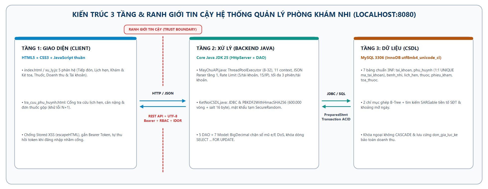
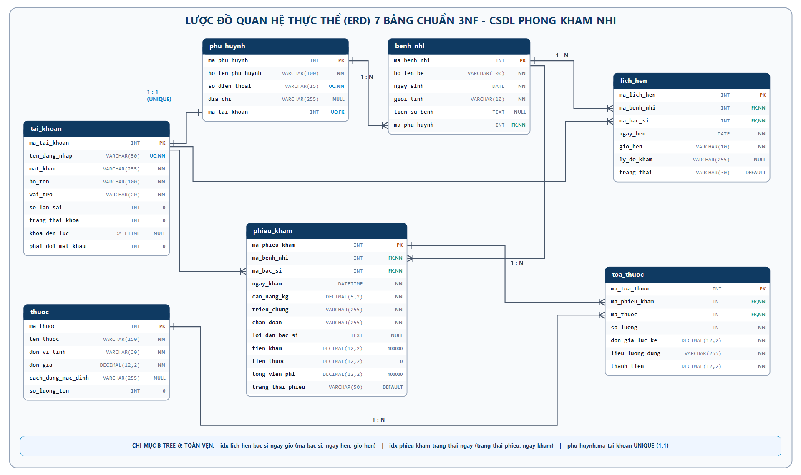

# Hướng dẫn Cài đặt và Triển khai Hệ thống (`setup/`)

Tài liệu này hướng dẫn chi tiết cách thiết lập cơ sở dữ liệu mẫu, biên dịch mã nguồn và khởi chạy phần mềm thuộc đề tài **Xây dựng ứng dụng quản lý phòng khám nhi** trên môi trường triển khai tiêu chuẩn để cài đặt, chạy thử và kiểm chứng đầy đủ các chức năng đã hoàn thành tính đến mốc 20/11/2026 (Tuần 06/08).

---

## 1. Sơ đồ Triển khai Kiến trúc 3 Tầng

Hệ thống vận hành độc lập trên môi trường mạng nội bộ (LAN / Localhost) mà không yêu cầu cài đặt trình quản lý gói ngoài (`Maven`, `Gradle`, `Node.js`), kết nối từ trình duyệt Web qua máy chủ HTTP Core Java (`cổng 8080`) xuống hệ quản trị MySQL (`cổng 3306`):



---

## 2. Lược đồ Cơ sở Dữ liệu Vật lý (7 Bảng Chuẩn 3NF)

Toàn bộ cấu trúc bảng, khóa ngoại và 2 chỉ mục ghép tối ưu truy vấn được định nghĩa tại [co_so_du_lieu.dbml](co_so_du_lieu.dbml) và cài đặt trực tiếp trong [khoi_tao_csdl.sql](khoi_tao_csdl.sql):



---

## 3. Quy trình Cài đặt Chuẩn (Từng Bước)

### Bước 1: Kiểm tra Java JDK và MySQL Server
1. Mở cửa sổ **Command Prompt** hoặc **PowerShell**, gõ `javac -version` để xác nhận máy đã cài đặt **Java JDK** (khuyến nghị JDK 17 trở lên; dự án phát triển trên JDK 25).
2. Mở **XAMPP Control Panel** và khởi động dịch vụ **MySQL** ở cổng mặc định `3306`.

### Bước 2: Nạp kịch bản CSDL và dữ liệu thử nghiệm
1. Truy cập `http://localhost/phpmyadmin` (hoặc dùng MySQL Workbench / DBeaver / dòng lệnh `mysql -u root -p < khoi_tao_csdl.sql`).
2. Mở thẻ **SQL**, sao chép toàn bộ nội dung tệp [khoi_tao_csdl.sql](khoi_tao_csdl.sql) và nhấn **Go** để thực thi.
   - *Lưu ý quan trọng:* Tệp SQL mở đầu bằng lệnh `DROP DATABASE IF EXISTS phong_kham_nhi;` để tạo mới sạch hoàn toàn 7 bảng với bảng mã `utf8mb4_unicode_ci`, nạp sẵn 4 tài khoản mẫu (`admin`, `bacsi1`, `letan1`, `0901234567`), 1 hộ phụ huynh, 2 bệnh nhi (SĐT `0901234567` liên kết 2 anh em ruột Phạm Gia Bảo và Phạm Ngọc Hân), 3 mặt hàng thuốc nhi khoa, 2 lịch hẹn, 2 phiếu khám (Phiếu `#1` đã thanh toán `14,20 kg` và Phiếu `#2` chờ thu tiền `14,50 kg`) và 3 dòng toa thuốc đối chứng.
3. Kiểm tra tệp cấu hình `../scr/config/database.properties` (tự động sinh từ `../scr/config/database.properties.example` khi chạy `chay_he_thong.bat` và được chặn đẩy lên Git trong `.gitignore`):
   ```properties
   db.url=jdbc:mysql://localhost:3306/phong_kham_nhi?useSSL=false&allowPublicKeyRetrieval=true&characterEncoding=UTF-8
   db.user=root
   db.password=
   ```
   Nếu MySQL trên máy chủ cục bộ phòng khám có đặt mật khẩu `root` hoặc chạy cổng khác `3306`, cập nhật lại giá trị tương ứng.

### Bước 3: Chạy kịch bản tự động biên dịch và bật máy chủ
1. Tại thư mục `setup/`, nhấp đúp chuột vào tệp [chay_he_thong.bat](chay_he_thong.bat).
2. Để chỉ kiểm tra biên dịch không bật máy chủ, có thể chạy qua dòng lệnh:
   ```bat
   setup\chay_he_thong.bat --compile-only
   ```
3. Khi màn hình dòng lệnh hiển thị thông báo máy chủ khởi động thành công tại `http://localhost:8080`, giữ nguyên cửa sổ console và mở trình duyệt Web:
   - Giao diện nhân sự phòng khám: `http://localhost:8080` (`admin` / `123456`, `bacsi1` / `123456`, `letan1` / `123456`)
   - Cổng tra cứu phụ huynh: `http://localhost:8080/tra_cuu_phu_huynh.html` (`0901234567` / `123456`)

---

## 4. Xử lý Sự cố Thường gặp khi Chuyển Máy

| Hiện tượng | Nguyên nhân | Cách khắc phục nhanh |
| :--- | :--- | :--- |
| Báo lỗi `'javac' is not recognized` | Biến môi trường `PATH` chưa trỏ tới thư mục `bin` của JDK | Cài đặt Java JDK 21/25 và thêm đường dẫn `C:\Program Files\Java\jdk-...\bin` vào `PATH` |
| Báo lỗi `BindException: Address already in use` | Cổng `8080` đang bị một tiến trình khác chiếm giữ | Đóng cửa sổ `MayChuAPI` cũ hoặc tắt dịch vụ đang chiếm cổng `8080` trước khi chạy lại `.bat` |
| Đăng nhập báo không kết nối được CSDL | Dịch vụ MySQL chưa bật hoặc sai `db.password` | Bật MySQL trong XAMPP (`cổng 3306`) và kiểm tra lại tệp `scr/config/database.properties` |

---

## 5. Thông tin Liên hệ Hỗ trợ Kỹ thuật

- **Sinh viên thực hiện:** Trần Đăng Khoa (`MSSV: 110124097` - Lớp `DA24TTA`)
- **Điện thoại:** `0867749262` | **Email:** `110124097@st.tvu.edu.vn`
- **Giảng viên hướng dẫn:** ThS. Nguyễn Thừa Phát Tài
